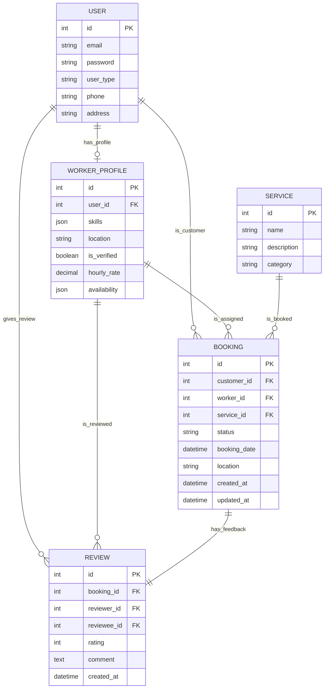

# Database Documentation - Nexus WeFix

This document explains how the database is structured, how tables are created, and where key queries are located in the codebase.

## 1. Table Creation & Management

In this Django project, tables are **defined in `models.py`** and **created via migrations**.

- **App: `accounts`** -> [models.py](file:///media/vyshnav/Inventory/Storage/Freelance/projects/Nexus_WeFix/src/apps/accounts/models.py)
- **App: `workers`** -> [models.py](file:///media/vyshnav/Inventory/Storage/Freelance/projects/Nexus_WeFix/src/apps/workers/models.py)
- **App: `bookings`** -> [models.py](file:///media/vyshnav/Inventory/Storage/Freelance/projects/Nexus_WeFix/src/apps/bookings/models.py)

When models are modified, the following commands are used:
1. `python manage.py makemigrations` - Generates a Python file in `migrations/`.
2. `python manage.py migrate` - Executes the SQL to create/update tables in PostgreSQL.

---

## 2. Entity Relationship Diagram (ERD)

The diagram below shows how the core tables relate to each other:

---

## 3. Key Queries & Locations

Django uses its **Object-Relational Mapper (ORM)** to query the database. Instead of raw SQL, we use Python methods.

| Query Description | ORM Call | Location |
| :--- | :--- | :--- |
| **Get Customer's Bookings** | `Booking.objects.filter(customer=user).order_by('-booking_date')` | [bookings/views.py:44](file:///media/vyshnav/Inventory/Storage/Freelance/projects/Nexus_WeFix/src/apps/bookings/views.py#L44) |
| **Get Worker's Requests** | `Booking.objects.filter(worker=user.worker_profile).order_by('-booking_date')` | [bookings/views.py:48](file:///media/vyshnav/Inventory/Storage/Freelance/projects/Nexus_WeFix/src/apps/bookings/views.py#L48) |
| **Get Verified Professionals** | `WorkerProfile.objects.filter(is_verified=True).exclude(user=self.request.user).annotate(avg_rating=Avg('reviews__rating'))` | [workers/views.py:31](file:///media/vyshnav/Inventory/Storage/Freelance/projects/Nexus_WeFix/src/apps/workers/views.py#L31) |
| **Get Unique Skills List** | `WorkerProfile.objects.filter(is_verified=True).values_list('skills', flat=True)` | [workers/views.py:44](file:///media/vyshnav/Inventory/Storage/Freelance/projects/Nexus_WeFix/src/apps/workers/views.py#L44) |
| **Filter Services by Skill** | `Service.objects.filter(category__in=worker.skills)` | [bookings/forms.py:19](file:///media/vyshnav/Inventory/Storage/Freelance/projects/Nexus_WeFix/src/apps/bookings/forms.py#L19) |

---

## 4. How Queries are Called
Most queries are called within **Class-Based Views** inside `get_queryset()` or `get_context_data()`. Django handles opening and closing the database connections automatically.
